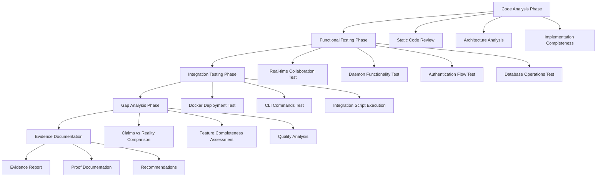

# Design Document

## Overview

This design document outlines a systematic approach to analyze the Mothership application and prove that it doesn't deliver on its advertised functionality. The analysis will be conducted through code examination, functional testing, and gap analysis to provide concrete evidence about the application's actual capabilities versus its marketing claims.

## Architecture

The analysis system will be structured as a multi-phase investigation with clear documentation and evidence collection at each stage.



## Components and Interfaces

### 1. Code Analysis Engine

**Purpose:** Systematically examine the codebase to identify implementation gaps and incomplete functionality.

**Key Functions:**
- Parse and analyze Rust source code
- Identify TODO comments, unimplemented functions, and placeholder code
- Analyze WebSocket implementation for real-time collaboration
- Examine database schema and migration completeness
- Review authentication and authorization implementation

**Interfaces:**
- File system access to read source code
- Static analysis tools for code quality assessment
- Documentation generation for findings

### 2. Functional Testing Framework

**Purpose:** Test actual functionality against advertised claims through automated and manual testing.

**Key Functions:**
- Test WebSocket connections for real-time sync
- Verify daemon startup and file watching
- Test OAuth authentication flows
- Validate database operations and persistence
- Check CLI command functionality

**Interfaces:**
- HTTP client for API testing
- WebSocket client for real-time testing
- Database connection for persistence testing
- Process management for daemon testing

### 3. Integration Test Runner

**Purpose:** Execute the provided integration tests and analyze their coverage and reliability.

**Key Functions:**
- Run PowerShell integration test script
- Monitor test execution and capture results
- Analyze test coverage against advertised features
- Document test failures and their causes

**Interfaces:**
- PowerShell script execution
- Test result capture and analysis
- Coverage reporting

### 4. Gap Analysis Processor

**Purpose:** Compare marketing claims with actual implementation to identify and document discrepancies.

**Key Functions:**
- Parse marketing documentation for feature claims
- Compare claims against code analysis results
- Quantify implementation completeness
- Generate evidence-based conclusions

**Interfaces:**
- Documentation parsing
- Comparison algorithms
- Report generation

## Data Models

### Analysis Result

```rust
struct AnalysisResult {
    feature_name: String,
    advertised_claim: String,
    actual_implementation: ImplementationStatus,
    evidence: Vec<Evidence>,
    confidence_level: ConfidenceLevel,
}

enum ImplementationStatus {
    FullyImplemented,
    PartiallyImplemented(f32), // percentage
    NotImplemented,
    PlaceholderOnly,
    Broken,
}

enum ConfidenceLevel {
    High,    // Direct code evidence
    Medium,  // Indirect evidence
    Low,     // Assumption based
}
```

### Evidence Record

```rust
struct Evidence {
    evidence_type: EvidenceType,
    source_file: Option<String>,
    line_number: Option<u32>,
    description: String,
    code_snippet: Option<String>,
    test_result: Option<TestResult>,
}

enum EvidenceType {
    CodeAnalysis,
    FunctionalTest,
    IntegrationTest,
    DocumentationReview,
}
```

### Feature Assessment

```rust
struct FeatureAssessment {
    feature_category: FeatureCategory,
    advertised_features: Vec<String>,
    implemented_features: Vec<String>,
    missing_features: Vec<String>,
    broken_features: Vec<String>,
    overall_score: f32, // 0.0 to 1.0
}

enum FeatureCategory {
    RealTimeCollaboration,
    BackgroundSync,
    Authentication,
    DatabasePersistence,
    CLIInterface,
    Deployment,
}
```

## Error Handling

### Analysis Errors

- **Code Access Errors:** Handle cases where source files cannot be read
- **Compilation Errors:** Document when code doesn't compile or has syntax issues
- **Test Execution Errors:** Capture and analyze test failures
- **Network Errors:** Handle connectivity issues during functional testing

### Evidence Validation

- **Source Verification:** Ensure all evidence is traceable to specific code locations
- **Test Reliability:** Validate that test results are consistent and reproducible
- **Documentation Accuracy:** Cross-reference claims with actual implementation

## Testing Strategy

### Phase 1: Static Analysis Testing

1. **Code Compilation Test**
   - Attempt to build all Rust components
   - Document compilation errors and warnings
   - Verify dependency resolution

2. **Architecture Review Test**
   - Analyze component dependencies
   - Verify interface implementations
   - Check for circular dependencies

3. **Implementation Completeness Test**
   - Search for TODO comments and unimplemented functions
   - Analyze function bodies for placeholder implementations
   - Check for proper error handling

### Phase 2: Functional Testing

1. **Real-Time Collaboration Test**
   ```bash
   # Test WebSocket connectivity
   # Simulate multiple clients
   # Measure sync latency
   # Test conflict resolution
   ```

2. **Daemon Functionality Test**
   ```bash
   # Test daemon startup
   # Verify file watching
   # Test IPC communication
   # Check graceful shutdown
   ```

3. **Authentication Flow Test**
   ```bash
   # Test OAuth initiation
   # Verify token handling
   # Test session persistence
   # Check authorization
   ```

4. **Database Operations Test**
   ```bash
   # Test database connectivity
   # Verify CRUD operations
   # Test migration execution
   # Check data integrity
   ```

### Phase 3: Integration Testing

1. **Docker Deployment Test**
   ```bash
   # Build Docker images
   # Start Docker stack
   # Test service connectivity
   # Verify health endpoints
   ```

2. **CLI Commands Test**
   ```bash
   # Test each CLI command
   # Verify error handling
   # Check help documentation
   # Test command chaining
   ```

3. **End-to-End Workflow Test**
   ```bash
   # Run provided integration tests
   # Test complete user workflows
   # Verify data persistence
   # Check cleanup operations
   ```

### Phase 4: Performance and Reliability Testing

1. **Load Testing**
   - Test with multiple concurrent users
   - Measure WebSocket connection limits
   - Test database performance under load

2. **Reliability Testing**
   - Test error recovery
   - Verify data consistency
   - Check system stability over time

## Implementation Approach

### 1. Automated Code Analysis

Use static analysis tools and custom scripts to:
- Parse Rust source code for implementation patterns
- Identify incomplete or placeholder implementations
- Generate code quality metrics
- Document architectural decisions

### 2. Systematic Functional Testing

Create test suites that:
- Test each advertised feature independently
- Measure actual performance against claims
- Document failure modes and error conditions
- Provide reproducible test cases

### 3. Evidence Collection Framework

Build a system that:
- Automatically captures test results
- Links evidence to specific code locations
- Generates traceable documentation
- Provides confidence ratings for conclusions

### 4. Comprehensive Reporting

Generate reports that:
- Compare claims to reality with specific examples
- Provide quantitative assessments of implementation completeness
- Include code snippets and test results as evidence
- Offer clear conclusions with supporting data

## Success Criteria

The analysis will be considered successful when it provides:

1. **Comprehensive Coverage:** All major advertised features have been analyzed
2. **Evidence-Based Conclusions:** Every claim is supported by concrete evidence
3. **Reproducible Results:** All tests and analyses can be repeated with consistent results
4. **Clear Documentation:** Findings are clearly documented with specific examples
5. **Actionable Insights:** The analysis provides clear understanding of what works and what doesn't

## Risk Mitigation

### Technical Risks

- **Code Complexity:** Break analysis into manageable components
- **Test Environment Issues:** Use containerized testing environments
- **Dependency Problems:** Document all dependencies and versions

### Analysis Risks

- **Bias in Interpretation:** Use objective metrics and multiple validation methods
- **Incomplete Coverage:** Systematically check all advertised features
- **False Positives:** Validate findings through multiple testing approaches

## Deliverables

1. **Code Analysis Report:** Detailed examination of implementation completeness
2. **Functional Test Results:** Comprehensive testing of all advertised features
3. **Integration Test Analysis:** Results from running provided test suites
4. **Gap Analysis Document:** Systematic comparison of claims vs. reality
5. **Evidence Portfolio:** Collection of all supporting evidence and documentation
6. **Executive Summary:** High-level conclusions with key findings and recommendations